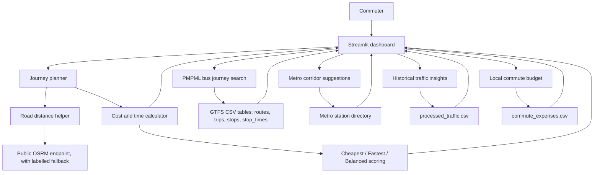

# PuneSahayak — System Architecture

## Main flow
1. Streamlit collects the user's selected areas, travel days, budget and travel preference.
2. Pandas loads the relevant CSV/GTFS data.
3. Python helper modules calculate road distance, estimated travel time/cost, route matches and traffic summaries.
4. The recommendation function ranks cost/time choices using an explainable score.
5. Streamlit and Plotly display results; expense entries are saved locally to CSV.

## Key limitations
- OSRM is an external road-distance service; a straight-line-based fallback is labelled if it is unavailable.
- PMPML GTFS data is a community snapshot without service calendar files or live GPS.
- Metro data is a station/corridor directory, not a train timetable.
- Historical traffic counts do not measure speed and are not used to predict route delay.
